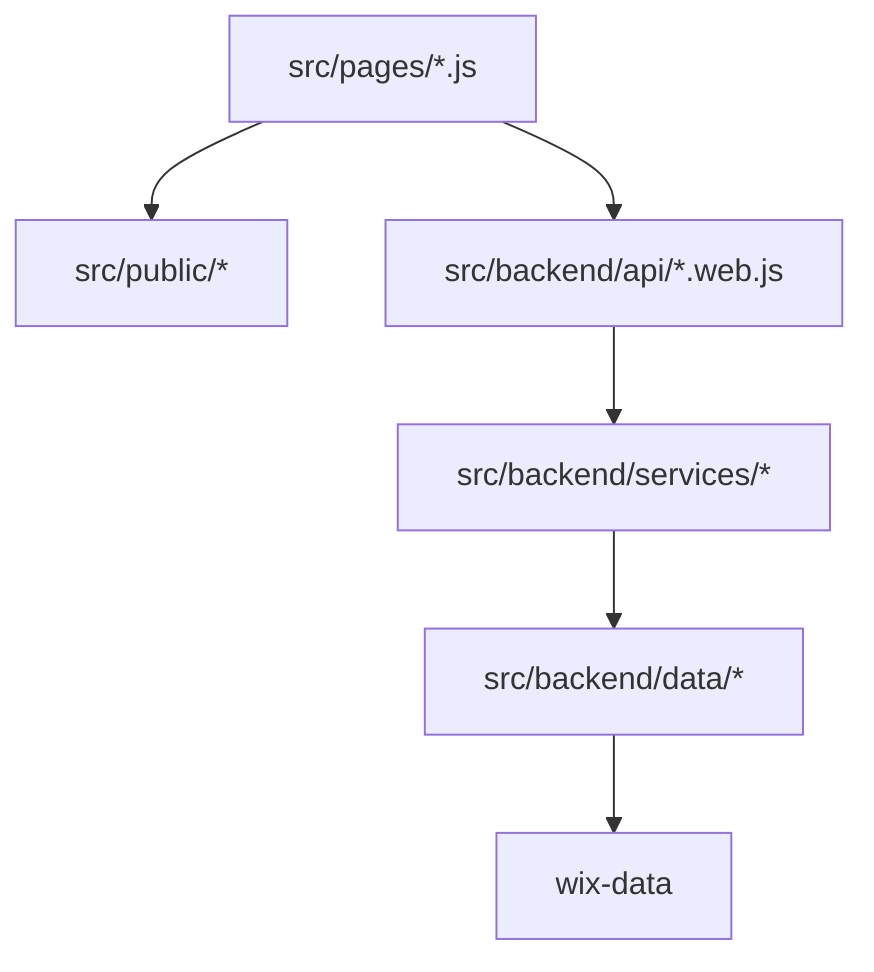

# Architecture Organize (Wix Studio + Velo)

## Objectif
Mettre en place une architecture en couches claire, maintenable et alignée avec les contraintes du projet.

## Schéma des couches

## Flux de données (exemple : formulaire contact)
1. La page Home déclenche un envoi depuis le front (`src/pages/*.js`).
2. La page appelle le web module `leads.web.js` (`submitContactLead()`).
3. Le web module valide les entrées et délègue à `leadsService.js`.
4. Le service applique la logique métier (normalisation, règles, messages).
5. Le service appelle `leadsRepository.js`.
6. Le repository persiste dans la collection `Leads` via `wix-data`.
7. La réponse remonte jusqu'à la page avec un format cohérent.

## Règles de dépendance
- `pages` → `public/*` et `backend/api/*.web.js`
- `api` → `services`
- `services` → `data`
- `data` → `wix-data` (seul endroit autorisé)
- `public` ne dépend jamais de `backend` (sauf appel de web modules effectué depuis `pages`)

## Décisions et justifications
- **Un repository par collection** : réduit le couplage et simplifie l'évolution du schéma CMS.
- **Deux web modules seulement (`leads.web.js`, `content.web.js`)** : surface d'API backend minimale et lisible.
- **Services dédiés (`leadsService.js`, `contentService.js`)** : séparation stricte validation/transport vs logique métier.
- **Motion encapsulée côté `public/motion`** : cohérence des animations légères sans dupliquer les interactions natives Wix.
- **`events.js` réservé aux réactions app (ex. Bookings)** : intégration propre aux événements système Wix.

## TODO Phase suivante
- Implémenter la logique métier et la validation réelle.
- Brancher les repositories à `wix-data`.
- Définir les permissions fines des web modules dans `permissions.json`.
